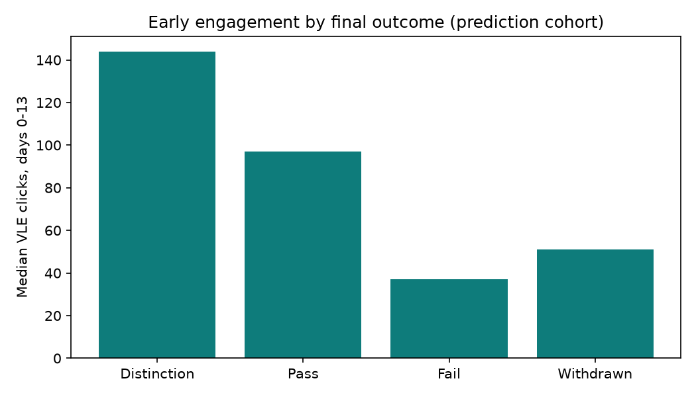
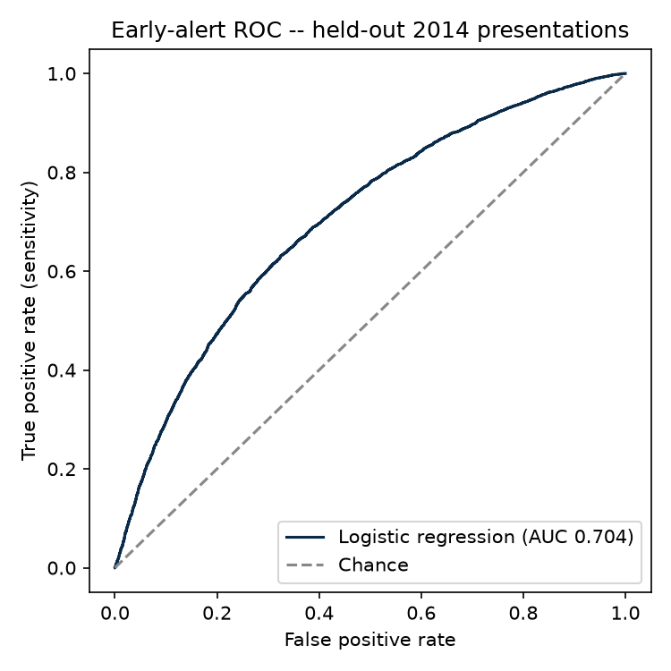

<div align="center">

# 🚨 OULAD Early Alert

**How early can you see a student leaving? A day-14 early-warning test on the Open University's real clickstream.**

[](#data--provenance)
[](#the-question)
[](#the-model)
[](LICENSE)

*32,593 registrations, 10.66 million VLE interaction records, seven modules — one honest question:
what does the first fortnight actually tell you about who will withdraw or fail?*

</div>

---

## Why this exists

Every institution that runs online or blended courses buys the same promise: *learning analytics will flag
at-risk students early enough to help them.* The honest version of that question is narrower and harder —
**how much signal exists in the first 14 days, before the first real assessment is even due, and how many
students are already gone by then?** This repo answers it on OULAD, the Open University Learning Analytics
Dataset: a fully scripted pipeline from the raw release files to a held-out evaluation.

> **Every number below comes from the executed pipeline.** Metrics are saved to `outputs/metrics.json` by the
> analysis script itself; the README quotes that file. If a number isn't in the run, it isn't in the README.

## The question

**How early can VLE engagement + assessment signals identify students who will withdraw or fail?**

| Design choice | What was done, and why |
|---|---|
| Cohort | All **32,593** student×module registrations in `studentInfo.csv` (7 modules, 22 presentations, 2013B–2014J) |
| Outcome | At-risk = final result **Withdrawn** or **Fail** (17,208 students, **52.8%**); not-at-risk = Pass or Distinction |
| Alert day | **Day 14.** Predictors use only days 0–13 of VLE/assessment activity, plus enrolment-time fields |
| Prediction cohort | Students **still enrolled on day 14** (n = **28,128**). Students who had already left are counted separately — an alert cannot help them, and leaving them in would leak the answer (their clicks stop *because* they left) |
| Split | **Temporal** — train on 2013 presentations (n = 12,096), test on 2014 (n = 16,032). No test-year outcome touches fitting |
| Model | Logistic regression — standardised numerics, one-hot categoricals, coefficients published. Chosen because an early-alert model a tutor cannot inspect is a model nobody should act on |

## Key findings

### 1 · Nearly half of all withdrawals happen before a day-14 alert could fire

Of **10,156** withdrawals, **4,457 (43.9%)** occurred by day 14 — and **2,676 students withdrew before day 0**,
after registering but before their module even started. Any early-alert design that begins "once the course
is under way" is structurally late for the largest single group of leavers. The first alert problem is an
*enrolment* problem.

### 2 · The engagement gradient is visible in the first fortnight — and it is steep

Median VLE activity in days 0–13, students still enrolled on day 14:



| Final outcome | Median clicks | Median active days | Zero-activity share |
|---|---|---|---|
| Distinction | **144** | 7 | 3.4% |
| Pass | **97** | 5 | 5.4% |
| Withdrawn | 51 | 4 | 13.6% |
| Fail | **37** | 3 | 17.3% |

Students who eventually failed typically clicked around a **quarter** as much as students who earned a
Distinction — in the first two weeks alone.

### 3 · Total silence is a strong signal — but a narrow one

**9.8%** of the prediction cohort had **zero active VLE days** in the first fortnight. **72.3%** of them
ended up withdrawn or failed, vs **42.4%** of students with any activity (risk ratio **1.71**). As a test-set
rule, "flag the silent" is precise (precision **71.7%**, specificity 95.4%) — but it catches only **14.4%**
of at-risk students. Most struggling students are *not* silent; they are quietly, intermittently present.

### 4 · In the first 14 days there is almost no assessment signal to use

Only **12.4%** of students had submitted anything by day 14, and the median first assessment wasn't due
until **day 21.5**. Early-warning systems sold on "assessment performance" are, in the first fortnight,
really engagement systems — the grades haven't happened yet. One enrolment-time signal does stand out:
students repeating a module ended at-risk **61.2%** of the time, vs **43.0%** for first attempts.

### 5 · A transparent model helps — as triage, not as verdict



| Held-out 2014 test (n = 16,032) | Value |
|---|---|
| AUC — full model | **0.704** |
| AUC — VLE engagement features only | 0.659 |
| Sensitivity @ 0.50 threshold | **52.4%** |
| Specificity @ 0.50 | 76.5% |
| Precision @ 0.50 | 64.6% |
| At-risk students captured by flagging the top-risk 20% | **31.3%** |

At the default threshold the model finds about half of the students who will withdraw or fail, and about
two of every three students it flags are genuinely at risk. That is a reasonable *triage list for a human
tutor* — and nowhere near accurate enough to label a student. The README will not pretend otherwise.

## Integrity checks (run, not asserted)

- **Row counts vs the dataset's own documentation** (`src/00_verify_data.py` →
  `outputs/data_verification.json`): the release matches `OULAD.names`, bundled inside the official zip, on
  courses (22), assessments (206), VLE materials (6,364), assessment submissions (173,912) and VLE log
  entries (**10,655,280**). Outcome counts from the data (Pass 12,361 · Withdrawn 10,156 · Fail 7,052 ·
  Distinction 3,024) reproduce the documentation's class distribution **exactly**.
- **A documentation typo, flagged rather than fixed quietly:** §5 of `OULAD.names` lists 32,953
  students/registrations, but its own §9 class distribution sums to **32,593** — the actual row count of both
  files. Secondary sources quoting 196 assessments, 6,365 VLE pages, 173,740 submissions, or a
  1,048,575-row `studentVle.csv` (a spreadsheet-export truncation) do not describe this release.
- **A release quirk, handled explicitly:** missing values in the UCI mirror are coded as `?`
  (unregistration dates, some scores, some IMD bands). The scripts read with `na_values="?"`; without that,
  date/score columns load as strings and comparisons fail loudly — verified during the build.
- **Determinism:** the full pipeline was run twice; every metric reproduced exactly.
- **Leakage discipline:** predictors dated after day 13 are never touched; early leavers are excluded from
  the prediction cohort and reported separately (Finding 1); the split is temporal, not random.

## Limitations — read before citing

1. **The model partly learns the module, not just the student.** Three of the six largest coefficients are
   module indicators (GGG −0.83, DDD +0.68, FFF +0.57): modules differ in difficulty, design and student mix.
   Deployed honestly, this model ranks students *within* a module; it must not compare across modules.
2. **Clicks are not learning.** VLE activity measures platform use. Students who study offline, share
   materials, or work from print are invisible to these features — one reason the silent-student rule,
   however precise, must trigger a conversation, never a sanction.
3. **Demographics are predictors here, with everything that implies.** Prior education and deprivation band
   carry real signal (No Formal quals +0.61; IMD 0–10% +0.58; HE Qualification −0.43). A production system
   using them needs a fairness review this research demo does not perform — and a hard rule that a flag
   opens support, not scrutiny.
4. **Context is 2013–14 UK distance learning.** The Open University's students, pacing and platform differ
   from a present-day campus LMS. The *shape* of the findings (timing, silence, missing early assessments)
   is the transferable part; the exact coefficients are not.
5. **One snapshot, one threshold.** Day 14 and the 0.50 threshold are stated design choices, not optima.
   Earlier windows (day 7), later windows, and cost-weighted thresholds are the obvious next experiments.
6. **"Withdrawn" is an administrative record.** 8 students are recorded as Fail despite also unregistering
   by day 14; withdrawal dates reflect processing as well as student decisions.

## Reproduce

```bash
python -m venv .venv && source .venv/bin/activate
pip install -r requirements.txt
python src/01_download_data.py   # OULAD zip from the UCI mirror, SHA-256 pinned (~45 MB)
python src/00_verify_data.py     # row counts vs the release's own documentation
python src/02_early_alert.py     # features, model, charts -> outputs/metrics.json
```

Raw data lands in `data/raw/` and is never committed (see `data/README_DATA.md`).

## Data & provenance

**Source:** Kuzilek, J., Hlosta, M., & Zdrahal, Z. (2017). *Open University Learning Analytics dataset.*
Scientific Data, 4, 170171. Released by The Open University / Knowledge Media Institute, December 2015.

The canonical request page (https://analyse.kmi.open.ac.uk/open_dataset, now redirecting to the OU Analyse
site) serves the download behind a request form, so this project fetches the **identical December-2015
release from the UCI Machine Learning Repository** (dataset 349, DOI
[10.24432/C5KK69](https://doi.org/10.24432/C5KK69)) — file timestamps inside the zip are the original 2015
ones, and the download script pins the zip's SHA-256
(`f2ed1902616c1fe8d2824d872c0b7d2d72be435bf0124d077044fe4be2c6d3e4`, checked 2026-10-27) and refuses to
proceed if upstream bytes ever change.

**Licence:** OULAD is **CC BY 4.0** (attribution required). The raw CSVs are ~464 MB uncompressed
(`studentVle.csv` alone ~433 MB), so they are distributed by the download script, not by this repo.

## Repository layout

```
oulad-early-alert/
├── src/
│   ├── 00_verify_data.py    # row counts vs OULAD.names documentation
│   ├── 01_download_data.py  # UCI mirror download, checksum-pinned
│   └── 02_early_alert.py    # day-14 features, logistic model, charts
├── data/
│   ├── README_DATA.md       # licence, provenance, the "?" missing-value quirk
│   └── raw/                 # downloaded CSVs (git-ignored, ~464 MB)
└── outputs/
    ├── metrics.json             # every number in this README
    ├── data_verification.json   # counts vs documentation
    ├── results_summary.md       # the same results, as a one-page brief
    └── charts/                  # engagement-by-outcome, ROC curve
```

## License

Code: MIT — see [LICENSE](LICENSE). Data: CC BY 4.0, © The Open University (see above).
